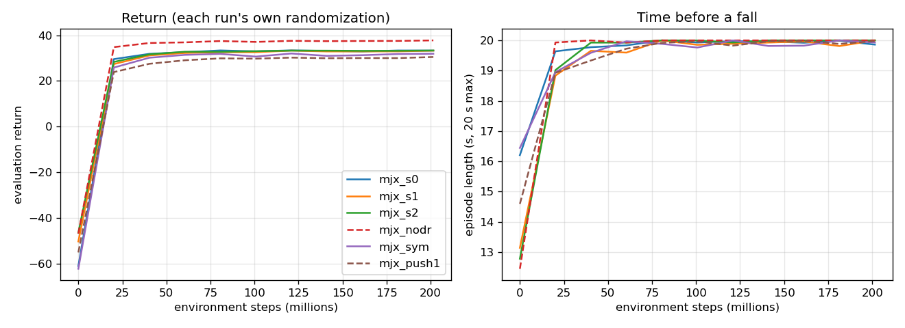
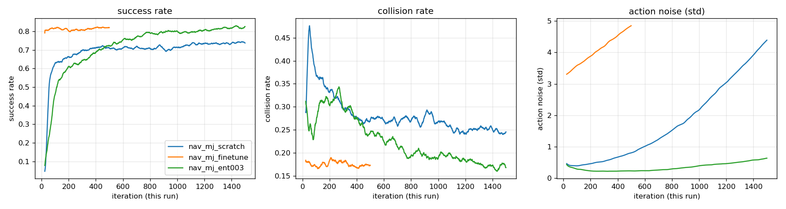

# Training in MuJoCo: walking (MJX) and navigation (CPU MuJoCo)

Phase 2 trained both policies in Isaac Lab (Tasks 1 and 4) and used MuJoCo only to check them. This part trains both policies inside MuJoCo, on Unitree's own Go2 model, and evaluates them on the full model with many more test conditions. Isaac Sim's renderer does not run on the Dell's driver (`LOG.md`, job 041), so this also brings training and video onto one simulator.

**Status (2026-11-07):** built and run. Every number comes from a Dell job's output (jobs 100 to 150).
- **Walking:** the MuJoCo-trained walker (200M steps, 27 min) falls less and tracks forward speed about twice as well as the Isaac walker on Unitree's full model. The stronger-push variant falls in 13 of 1300 test episodes.
- **Navigation:** the navigation policy trained in MuJoCo over that walker reaches the target in 0.860 ± 0.025 of the 200 test scenarios, against 0.675 for A*.

## What was built

| piece | file | what it does |
| :--- | :--- | :--- |
| training model | `go2x/mjx/go2_model.py` | Unitree's `go2.xml` (`unitree_mujoco` `1eb6642`), same bodies, masses, inertias, joint damping, armature and friction loss; only feet and knees touch the floor, pyramidal friction cone, 4 solver iterations |
| walking task | `go2x/mjx/walk_env.py`, `config/walk_mjx.yaml` | the Isaac walker's task in MJX (MuJoCo in JAX, on the GPU) |
| walking trainer | `scripts/mjx/train_walk.py` | Brax PPO (proximal policy optimization), 8192 robots in parallel; exports TorchScript with the Isaac walker's interface |
| export | `go2x/mjx/export.py` | Brax parameters to TorchScript; checked against Brax's own inference (difference below 1e-6) |
| walking evaluation | `scripts/mjx/eval_walk.py` | CPU MuJoCo on the **full** `go2.xml` (every collision geom, elliptic cone, 100 solver iterations), 13 test conditions, 100 episodes each |
| navigation environment | `go2x/mjnav/env.py` | the Isaac navigation task's own code (layouts, moving people, drawn image with camera noise, rewards) over CPU MuJoCo physics on the full `go2.xml`, with a frozen walker |
| navigation trainer | `scripts/mjnav/train_nav.py` | RSL-RL 3.1.2 PPO with attempt 4's settings and network |
| navigation evaluation | `scripts/mjnav/eval_nav.py` | the 200 fixed scenarios, Isaac's metrics |
| videos | `scripts/mjx/record_walk.py`, `jobs/150_videos_mujoco.sh` | learning progress, walking course, navigation runs, digital twin |
| tests | `tests/test_mjx.py` | training model stands still, position-actuator PD equals the Python PD (1e-12 rad), export equals a numpy forward pass, MJX environment, navigation environment |

The trained walker is a drop-in replacement for the Isaac walker: same 45-value observation, same joint order, same `target = default + 0.25 * output` (the export rescales). `scripts/robot/run_nav_policy.py --walk-policy` and `scripts/mujoco_check.py --policy` take it unchanged.

## Methods and where they come from

| choice | source |
| :--- | :--- |
| massively parallel on-policy training, thousands of robots on one GPU, short episodes, reward terms for velocity tracking, feet air time, smoothness and pushes up to 1 m/s | Rudin, Hoeller, Reist and Hutter, "Learning to Walk in Minutes Using Massively Parallel Deep Reinforcement Learning," CoRL 2021, PMLR 164:91-100 (legged_gym) |
| MJX simulation, Brax PPO settings (8192 environments, unroll 20, 32 minibatches, discount 0.97, learning rate 3e-4, entropy 0.01, 512-256-128 networks), environment structure, model randomization (link masses, center of mass, joint friction and armature) | Zakka et al., "MuJoCo Playground," arXiv:2502.08844, RSS 2025 (Go1 joystick task, `playground` 0.2.0) |
| PPO | Schulman et al., "Proximal Policy Optimization Algorithms," arXiv:1707.06347, 2017 |
| critic sees privileged state (true velocity, contacts, friction, randomized parameters), actor sees only what the robot measures | Pinto, Andrychowicz, Welinder, Zaremba and Abbeel, "Asymmetric Actor Critic for Image-Based Robot Learning," RSS 2018 |
| domain randomization of friction, mass, motor strength, PD gains, latency, sensor noise | Tobin et al., "Domain Randomization for Transferring Deep Neural Networks from Simulation to the Real World," IROS 2017; Peng, Andrychowicz, Zaremba and Abbeel, "Sim-to-Real Transfer of Robotic Control with Dynamics Randomization," ICRA 2018 |
| learned walking policy under a learned or planned high-level layer; velocity-command interface | Hwangbo et al., "Learning agile and dynamic motor skills for legged robots," Science Robotics 4(26), 2019; Lee et al., "Learning quadrupedal locomotion over challenging terrain," Science Robotics 5(47), 2020 |
| navigation reward on progress toward a goal, success and collision terms, trained over a locomotion policy | Rudin, Hoeller, Bjelonic and Hutter, "Advanced Skills by Learning Locomotion and Local Navigation End-to-End," IROS 2022 (arXiv:2209.12827) |
| several seeds per configuration, ablations one change at a time, means with standard errors | Henderson et al., "Deep Reinforcement Learning That Matters," AAAI 2018; Agarwal et al., "Deep Reinforcement Learning at the Edge of the Statistical Precipice," NeurIPS 2021 |
| simulator | Todorov, Erez and Tassa, "MuJoCo: A physics engine for model-based control," IROS 2012; Freeman et al., "Brax," NeurIPS 2021 Datasets and Benchmarks |

## The walking task

Same as the Isaac walker (`config/walk.yaml`, unitree_rl_lab Go2 velocity task `4960b84`), so the two trainers are compared on one task:

- **Observation (45):** angular velocity x 0.2, projected gravity, velocity target, joint angles minus the default pose, joint speeds x 0.05, previous action.
- **Actuation:** PD at every 5 ms physics step, kp 25 N m/rad, kd 0.5 N m s/rad, torque clipped to the motor limits (23.7 N m hip and thigh, 45.4 N m knee); policy at 50 Hz.
- **Rewards:** the 16 unitree_rl_lab terms and weights (`config/walk_mjx.yaml`), times the 0.02 s step, as Isaac Lab.
- **Terminations:** tilt above 0.8 rad, base box touching the floor; 20 s episodes.
- **Velocity targets:** vx -0.5 to 1.0 m/s, vy ±0.5 m/s, wz ±1.0 rad/s, new target every 10 s, 10 % zero.
- **Randomization:** walk.yaml's ranges (foot friction 0.3 to 1.2, base mass -1 to +3 kg, motor strength, kp and kd 0.8 to 1.2, latency, pushes ±0.5 m/s every 5 to 10 s, sensor noise) plus Playground's model randomization.

Differences, all forced by the simulator or trainer:
- Brax's policy is tanh-bounded, so the action scale is 0.5 rad (Playground's Go1) instead of 0.25 rad on an unbounded output. The export rescales, so the interface is the same.
- Contacts are geometric on the flat floor (foot within 5 mm of the floor).
- Latency 0 to 40 ms instead of 20 to 40 ms, because the MuJoCo robot backend runs with none.
- Episodes start with the feet on the floor.
- No command curriculum.

Two training-model settings were found by testing, not taken from a paper (`scripts/mjx/check_contacts.py`, 4 s of PD on the default pose):

| contact settings | base speed (m/s) | foot hop (cm) | drift in 4 s (m) |
| :--- | ---: | ---: | ---: |
| full `go2.xml` (elliptic cone, impratio 100, 100 iterations) | 0.000 | 0.0 | 0.037 |
| feet only, elliptic cone, 4 iterations | 0.269 | 40.9 | 0.798 |
| feet only, pyramidal cone, 4 iterations (used) | 0.004 | 0.1 | 0.016 |

- The elliptic cone needs many solver iterations; with 4 the feet chattered.
- Dropping the robot from 0.40 m, as Isaac does, pitched the head into the floor before any policy acted, so episodes start with the feet on the floor.

## The navigation task in MuJoCo

`go2x/mjnav/env.py` reuses the Isaac task's code above the physics unchanged:
- `AtriumBatch` (layouts, people scripts, footprints, success and collision checks);
- `CameraFeed` (15 Hz drawn frames, 0.1 to 0.2 s delay, pose noise, missed detections);
- `reward_terms`, the action scaling, the observation layout and the critic's extra state.

The physics is the full `go2.xml` on the CPU, 1024 robots stepped together by MuJoCo's `rollout` module (20 C++ threads, about 520k physics steps per second on the Dell). The PD runs as position actuators, which equal the Python PD to 1e-12 rad (`tests/test_mjx.py`). The drawing, PPO and networks run on the GPU.

Differences from Isaac:
- Obstacles are checked by footprint only (no obstacle bodies, so no contact-force check); the robot runner checks the same way.
- A fall is tilt above 0.8 rad or base below 0.15 m.

## Runs

| job | run | what changes |
| :--- | :--- | :--- |
| 100 | probe | 30M steps, to measure throughput |
| 110 to 112 | `mjx_s0`, `mjx_s1`, `mjx_s2` | main configuration, seeds 0, 1, 2, 200M steps each |
| 113 | `mjx_nodr` | ablation: no randomization, no sensor noise, no pushes |
| 114 | `mjx_sym` | ablation: the critic sees only the policy's observation |
| 115 | `mjx_push1` | variant: pushes up to 1.0 m/s (legged_gym) instead of 0.5 |
| 120 | | every walker in CPU MuJoCo on the full model, 13 conditions x 100 episodes |
| 130 | `nav_mj_scratch` | navigation from scratch over `mjx_s0`, attempt 4 settings, 1500 iterations |
| 131 | `nav_mj_finetune` | attempt 4 (Isaac) fine-tuned over `mjx_s0`, 500 iterations |
| 132 | `nav_mj_ent003` | as 130 with entropy bonus 0.003 (attempt 4's action noise grew to 3.3) |
| 140 | | navigation controllers on the 200 scenarios in MuJoCo, over both walkers |
| 150 | | videos |

`mjx_s0` was fixed in advance as the walker for navigation, before any evaluation.

## Results

### Walking training (jobs 110 to 115)

Each run: 200M environment steps on the Dell's GPU (NVIDIA RTX 4000 Ada, 20 GB) in 27 to 28 min, about 123k steps per second. The export matches Brax's own inference to 3e-7 or better in every run. Files: `results/phase2/mujoco_walk/<run>/` (policy, configuration, progress, timing).

| run | minutes | final evaluation return | final episode length (of 1000 steps) |
| :--- | ---: | ---: | ---: |
| `mjx_s0` | 27.0 | 33.3 | 993 |
| `mjx_s1` | 27.8 | 33.3 | 1000 |
| `mjx_s2` | 27.8 | 33.3 | 1000 |
| `mjx_nodr` | 27.1 | 37.7 | 1000 |
| `mjx_sym` | 26.8 | 31.9 | 996 |
| `mjx_push1` | 27.8 | 30.5 | 999 |

Every run walks for the full 20 s episode by about 75M steps (about 10 min). Returns are measured under each run's own randomization, so they compare runs only loosely: `mjx_nodr` scores highest because its training world has no pushes or noise.

### Walking evaluation (job 120)

CPU MuJoCo on the full `go2.xml`, 100 episodes of 20 s per condition and policy, with job 040's velocity targets. Falls are counts out of 100; tracking errors are the mean ± standard error over episodes. Full tables (including sideways and turning error, torque and power): `results/phase2/mujoco_walk_eval/eval_walk.md`.

| condition | Isaac walker | `mjx_s0` | `mjx_s1` | `mjx_s2` | `mjx_nodr` | `mjx_sym` | `mjx_push1` |
| :--- | ---: | ---: | ---: | ---: | ---: | ---: | ---: |
| nominal | 0 | 0 | 0 | 0 | 1 | 0 | 0 |
| friction 0.2 | 3 | 0 | 0 | 0 | 0 | 0 | 0 |
| friction 0.8 | 0 | 0 | 0 | 0 | 6 | 0 | 0 |
| payload 3 kg | 0 | 1 | 0 | 0 | 1 | 0 | 0 |
| payload 5 kg | 0 | 1 | 1 | 0 | 1 | 0 | 0 |
| motors at 80 % | 0 | 0 | 0 | 0 | 0 | 0 | 0 |
| kp at 80 % | 0 | 0 | 0 | 0 | 1 | 0 | 0 |
| latency 20 ms | 0 | 0 | 0 | 0 | 3 | 0 | 0 |
| latency 40 ms | 0 | 0 | 0 | 0 | 6 | 0 | 0 |
| sensor noise | 0 | 0 | 0 | 0 | 0 | 0 | 0 |
| side push 1.0 m/s | 0 | 0 | 0 | 0 | 18 | 0 | 0 |
| side push 1.5 m/s | 50 | 40 | 38 | 33 | 99 | 44 | **1** |
| 5 cm steps (not in training) | 61 | 37 | 27 | 30 | 81 | 26 | **12** |
| **all 1300 episodes** | 114 | 79 | 66 | 63 | 217 | 70 | **13** |

Forward speed error (m/s, mean ± standard error over 100 episodes):

| condition | Isaac walker | `mjx_s0` | `mjx_s1` | `mjx_s2` | `mjx_push1` |
| :--- | ---: | ---: | ---: | ---: | ---: |
| nominal | 0.119 ± 0.003 | 0.060 ± 0.001 | 0.062 ± 0.002 | 0.063 ± 0.002 | 0.065 ± 0.002 |
| friction 0.2 | 0.185 ± 0.007 | 0.064 ± 0.002 | 0.061 ± 0.002 | 0.074 ± 0.002 | 0.065 ± 0.002 |
| payload 5 kg | 0.146 ± 0.004 | 0.059 ± 0.001 | 0.060 ± 0.001 | 0.059 ± 0.001 | 0.060 ± 0.002 |
| kp at 80 % | 0.167 ± 0.004 | 0.082 ± 0.002 | 0.084 ± 0.002 | 0.084 ± 0.002 | 0.085 ± 0.002 |
| side push 1.5 m/s | 0.178 ± 0.004 | 0.129 ± 0.003 | 0.128 ± 0.003 | 0.124 ± 0.003 | 0.120 ± 0.002 |
| 5 cm steps | 0.192 ± 0.008 | 0.197 ± 0.011 | 0.212 ± 0.011 | 0.197 ± 0.010 | 0.197 ± 0.010 |

What the data shows:
- **MuJoCo training versus the Isaac walker:**
  - The three seeds of the main configuration agree closely.
  - Across the 3 seeds (mean ± standard error over seeds, n = 3), the fall rate is 0.37 ± 0.02 under 1.5 m/s pushes (Isaac 0.50) and 0.31 ± 0.03 on 5 cm steps (Isaac 0.61).
  - Forward speed error is about half the Isaac walker's in every flat-ground condition: 0.061 ± 0.001 m/s nominal, against 0.119.
  - Turning error is about the same, 0.20 rad/s against 0.19.
  - Caveat: these tests run in MuJoCo, the simulator the new walkers trained in, so part of the gap is the Isaac walker's sim-to-sim transfer, not a better policy.
- **Randomization matters (`mjx_nodr`):**
  - Without randomization, pushes and noise, the walker tracks turns better on clean ground (0.11 rad/s).
  - It falls in 217 of 1300 episodes: 18 at 1.0 m/s pushes, 99 at 1.5 m/s, and some under latency and friction changes it never saw.
  - This matches Tobin et al. 2017 and Peng et al. 2018.
- **The privileged critic (`mjx_sym`) changes falls little** (70 against 63 to 79) but has worse speed tracking (0.077 against 0.061 nominal, 0.125 against 0.083 at kp 80 %). One seed per ablation, so the fall difference is within seed-to-seed spread.
- **Stronger training pushes (`mjx_push1`, 1.0 m/s as in legged_gym):**
  - It is the most robust walker: 1 fall in 100 under 1.5 m/s pushes, 12 in 100 on 5 cm steps it never trained on, and 13 in 1300 overall.
  - Tracking is no worse.
  - This is a single seed. It is the recommended walker for a next round, but `mjx_s0` stays the navigation walker because it was fixed before any evaluation.
- **Power:** the MuJoCo walkers draw 25 to 28 W on flat ground, against the Isaac walker's 22 W.

### Navigation training (jobs 130 to 132)

All three runs train over the frozen `mjx_s0` walker, with 1024 robots on the full `go2.xml`, at 10 to 11 s per iteration. Files: `results/phase2/mujoco_nav/<run>/` (actor, settings, per-iteration scalars).

| run | iterations | hours | training success at the end | action noise at the end |
| :--- | ---: | ---: | ---: | ---: |
| `nav_mj_scratch` (entropy 0.01) | 1500 | 4.5 | 0.74 | 4.4 |
| `nav_mj_finetune` (from Isaac attempt 4) | 500 | 1.5 | 0.82 | 4.9 |
| `nav_mj_ent003` (entropy 0.003) | 1500 | 4.3 | 0.82 | 0.64 |

- Success during training includes the policy's random action noise, so it understates the test numbers below.
- With attempt 4's entropy bonus (0.01), the action noise grew without limit in both runs, as it did in Isaac (3.3).
- With 0.003, the noise stayed below 1 and the run trained to a better policy (next table).

### Navigation evaluation (job 140)

The 200 fixed scenarios (`config/nav_eval_scenarios.json`) in CPU MuJoCo on the full `go2.xml`, deterministic actions, over the `mjx_s0` walker. Rates are over 200 scenarios with binomial standard errors. Full tables: `results/phase2/mujoco_nav_eval/`.

| controller | success | collision | fall | time to goal (s) |
| :--- | ---: | ---: | ---: | ---: |
| straight line | 0.575 ± 0.035 | 0.425 ± 0.035 | 0 | 3.78 ± 0.12 |
| A* planner | 0.675 ± 0.033 | 0.315 ± 0.033 | 0 | 4.54 ± 0.14 |
| Isaac attempt 4 (trained in Isaac Lab) | 0.810 ± 0.028 | 0.170 ± 0.027 | 0 | 3.44 ± 0.14 |
| `nav_mj_scratch` | 0.735 ± 0.031 | 0.255 ± 0.031 | 0 | 2.83 ± 0.09 |
| `nav_mj_finetune` | 0.835 ± 0.026 | 0.160 ± 0.026 | 0 | 3.28 ± 0.13 |
| **`nav_mj_ent003`** | **0.860 ± 0.025** | **0.135 ± 0.024** | 0 | 3.48 ± 0.14 |

Every controller faces the same 200 scenarios, so differences are paired per scenario (mean difference in success ± standard error, n = 200):

| comparison | difference | scenarios only the first solves | only the second |
| :--- | ---: | ---: | ---: |
| `nav_mj_ent003` - A* | +0.185 ± 0.029 | 39 | 2 |
| `nav_mj_ent003` - straight line | +0.285 ± 0.035 | 61 | 4 |
| `nav_mj_ent003` - `nav_mj_scratch` (entropy 0.003 vs 0.01) | +0.125 ± 0.026 | 28 | 3 |
| `nav_mj_ent003` - Isaac attempt 4 | +0.050 ± 0.026 | 19 | 9 |
| `nav_mj_ent003` - `nav_mj_finetune` | +0.025 ± 0.022 | 12 | 7 |
| Isaac attempt 4: `mjx_s0` walker - Isaac walker | -0.025 ± 0.022 | 7 | 12 |

What the data shows:
- **The navigation policy trained entirely in MuJoCo works.**
  - `nav_mj_ent003` reaches the target in 86 % of the scenarios and collides in 13.5 %, with no falls.
  - It beats the A* planner by 18.5 ± 2.9 points and straight-line driving by 28.5 ± 3.5 points.
- **The entropy bonus was the one setting that mattered.** Lowering it from 0.01 to 0.003 kept the action noise bounded and raised success by 12.5 ± 2.6 points, on one seed each.
- **Against Isaac attempt 4** the MuJoCo policy is ahead by 5.0 ± 2.6 points. That is under two standard errors on one seed, so the two are about equal.
- **Fine-tuning Isaac attempt 4 in MuJoCo** for 500 iterations gives 0.835, no clear change (+2.5 ± 2.4).
- **Walker swap:** attempt 4 does about as well on the new walker as on the Isaac walker (-2.5 ± 2.2 points). The walker is a clean drop-in.
- **Collisions remain the main failure.** People are the hardest targets: `nav_mj_ent003` succeeds on 0.79 ± 0.05 of person targets against 0.90 ± 0.03 for chairs.

### Videos (job 150)

`results/phase2/mujoco_videos/`, all physics in CPU MuJoCo on the full `go2.xml`, checked by eye:

| file | what it shows |
| :--- | :--- |
| `walk_progress.mp4` | the walker learning to walk: one 8 s clip per training snapshot of `mjx_s1` (0 to 200M steps, 11 clips). At 0 steps it stands still; from 20M steps it walks and turns |
| `walk_demo_mjx_s0.mp4` | 33 s course: forward at 0.3, 0.6 and 1.0 m/s, turns, sideways, backward, standing, two 0.8 m/s side kicks. No fall |
| `walk_demo_isaac.mp4` | the same course with the Isaac walker. No fall |
| `nav_scenario<NNN>.mp4` | `nav_mj_ent003` through the robot runner (`safety_limits_nav_sim_training`) on scenarios 2, 7, 23, 40, 77, 101, 150 (all reach the target) and 190 (the virtual bumper stops it after 6 steps) |
| `twin_scenario023.mp4` | the digital twin rebuilt from the scenario 23 log |

`mjx_s0` has no snapshots (job 110 started before the snapshot code), so the progress video uses seed 1.
